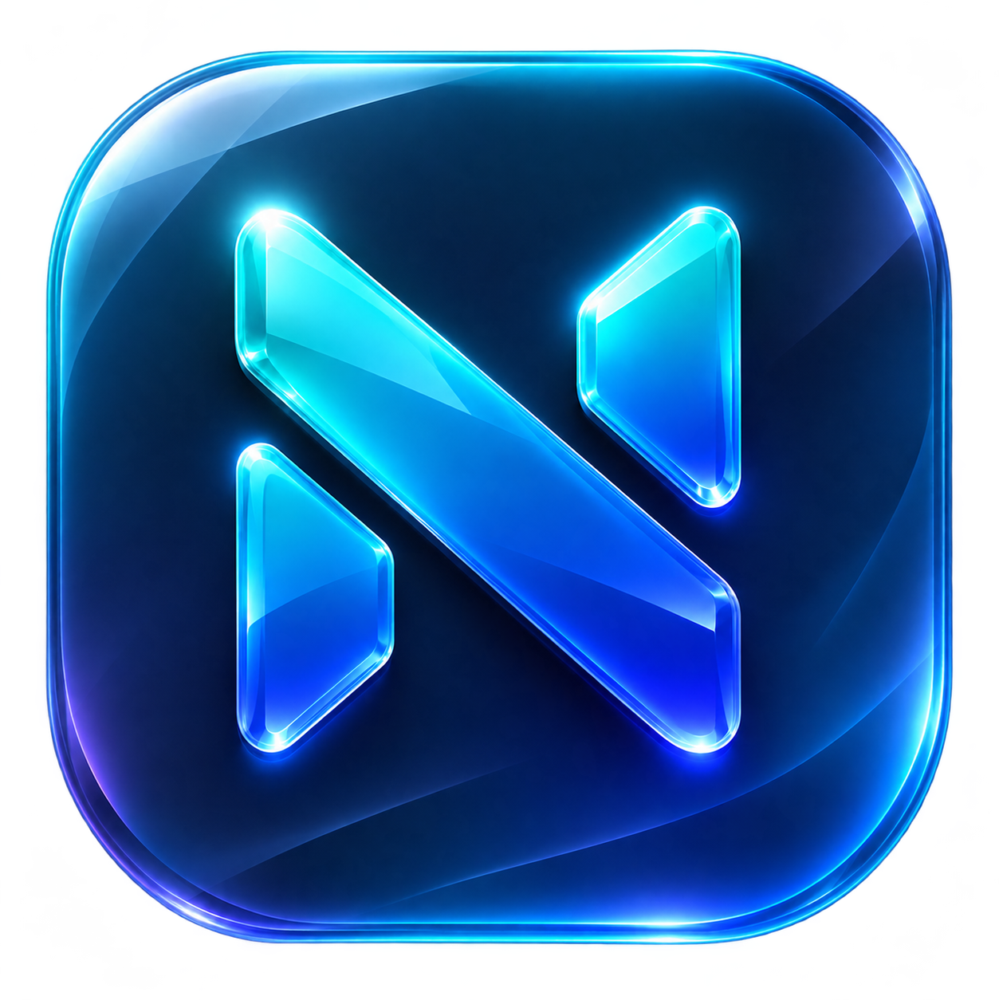

<div align="center">

**English** · [Español (README.md)](README.md)



# Nikao Dock

**macOS-style glass dock for Windows 10 and 11**

[](https://github.com/jhosepqr/Nikao-Dock/releases)
[](https://github.com/jhosepqr/Nikao-Dock/releases)
[](https://github.com/jhosepqr/Nikao-Dock/actions/workflows/fork-installer.yml)
[](LICENSE)
[](#installation)
[](#build-from-source)
[](https://github.com/jhosepqr/Nikao-Dock/stargazers)

<br />

<a href="https://github.com/jhosepqr/Nikao-Dock/releases">
  
</a>

&nbsp;

<a href="https://github.com/jhosepqr/Nikao-Dock/releases"></a>
&nbsp;
<a href="https://github.com/jhosepqr/Nikao-Dock/issues"></a>

</div>

Nikao Dock replaces the Windows taskbar with a translucent dock, an optional
top menu bar, and native drop-down panels. It targets daily use on Windows 10
and 11 with **near-zero CPU** while panels are closed.

> Based on [Muelle](https://github.com/crafter-station/Muelle) by Crafter
> Station. This fork does not auto-update to the official Muelle releases.

---

## Features

- **Live glass and blur** — Desktop blur through DWM, bright rim, transparency
  sliders in Settings.
- **Spotlight-style search** — Panel under the menu bar; Windows Search remains
  available as a setting.
- **Battery panel** — Charge, time estimates, and power mode without opening
  Quick Settings.
- **Menu bar** — Clock, network, volume, music/AI island, optional auto-hide.
- **Low idle cost** — No per-frame redraw or timers while flyouts are closed.

Classic dock behavior: magnification, groups, genie minimize, live thumbnails,
and a shortcuts folder.

---

## Screenshots

Reference images live in [`assets/screenshots/`](assets/screenshots/). Paths
below are placeholders until real captures are added:

| Suggested file | Contents |
| --- | --- |
| `assets/screenshots/dock-glass.png` | Glass dock and menu bar |
| `assets/screenshots/spotlight.png` | Search under the bar |
| `assets/screenshots/battery-panel.png` | Battery panel |

---

## Installation

1. Open [Releases](https://github.com/jhosepqr/Nikao-Dock/releases) and download
   **Nikao-Dock-Setup.exe** from pre-release
   [`v0.1.23-glass.4`](https://github.com/jhosepqr/Nikao-Dock/releases/tag/v0.1.23-glass.4)
   ([direct
   link](https://github.com/jhosepqr/Nikao-Dock/releases/download/v0.1.23-glass.4/Nikao-Dock-Setup.exe)).
   GitHub does not point `/releases/latest` at pre-releases.
2. **SmartScreen:** if Windows protected your PC, choose **More info → Run
   anyway** (this fork installer is unsigned).
3. If **Edge** warns about the download: **⋯ → Keep**.
4. Setup is **passive**: no wizard, per-user install under
   `%LOCALAPPDATA%\Programs\Nikao Dock`.

### Migrating from Muelle (earlier fork build)

Nikao Dock is a **separate** Apps & features entry. The installer turns off
Muelle autostart, stops that dock, and silently uninstalls it **without**
deleting `%APPDATA%\Muelle`. On first launch, Nikao Dock **copies** pins and
settings to `%APPDATA%\Nikao Dock`.

If **Muelle** still appears, uninstall it **without** deleting data. You should
end up with one app and one startup entry.

---

## Build from source

You need Windows 10 (1903+) or 11, Rust (MSVC), Node.js, and pnpm. On Linux
you can type-check with `cargo xwin clippy` (see CI).

```powershell
cargo run -p muelle

cd apps\settings
pnpm install
pnpm tauri dev
```

Fork installer on Windows:

```powershell
$env:MUELLE_FORK_BUILD = "1"
./scripts/build-installer.ps1
```

---

## Roadmap

- Real screenshots and clearer migration docs.
- More glass tuning across GPUs and Windows versions.
- Code signing when a certificate is available.

---

## Credits

- **Nikao Dock** — fork by [jhosepqr](https://github.com/jhosepqr).
- **Muelle** — original work by [Crafter Station](https://crafter-station.com);
  upstream at [crafter-station/Muelle](https://github.com/crafter-station/Muelle).

---

## License

MIT — see [LICENSE](LICENSE). The Crafter Station / Muelle contributors
copyright notice in the license file is unchanged.

---

<div align="center">

[](https://star-history.com/#jhosepqr/Nikao-Dock&Date)

</div>