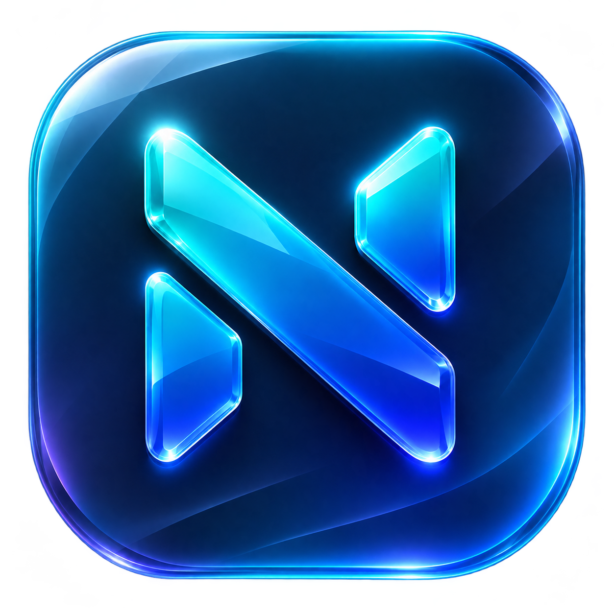

<div align="center">

[English](README.en.md)



# Nikao Dock

**Dock estilo macOS con vidrio para Windows 10 y 11**

[](https://github.com/jhosepqr/Nikao-Dock/releases)
[](https://github.com/jhosepqr/Nikao-Dock/releases)
[](https://github.com/jhosepqr/Nikao-Dock/actions/workflows/fork-installer.yml)
[](LICENSE)
[](#instalación)
[](#compilar-desde-código)
[](https://github.com/jhosepqr/Nikao-Dock/stargazers)

<br />

<a href="https://github.com/jhosepqr/Nikao-Dock/releases">
  
</a>

&nbsp;

<a href="https://github.com/jhosepqr/Nikao-Dock/releases"></a>
&nbsp;
<a href="https://github.com/jhosepqr/Nikao-Dock/issues"></a>

</div>

Nikao Dock reemplaza la barra de tareas de Windows por un dock translúcido, una
barra superior opcional y paneles nativos que caen desde arriba. Está pensado
para el día a día en Windows 10 y 11, con **uso de CPU cercano a cero** cuando
los paneles están cerrados.

> Basado en [Muelle](https://github.com/crafter-station/Muelle) de Crafter
> Station. Este fork no se actualiza solo al Muelle oficial.

---

## Características

- **Vidrio en vivo (glass / blur)** — Desenfoque del escritorio vía DWM, borde
  brillante y controles de transparencia en Ajustes.
- **Búsqueda tipo Spotlight** — Panel bajo la barra superior; opción de volver a
  la búsqueda de Windows.
- **Panel de batería** — Porcentaje, carga, tiempo estimado y modo de energía
  sin abrir los ajustes rápidos de Windows.
- **Barra superior** — Reloj, red, volumen, isla de música/IA y más; se puede
  ocultar al borde.
- **Bajo consumo en reposo** — Sin timers ni redibujado por frame mientras los
  flyouts están cerrados; el trabajo queda en el compositor de Windows.

Dock clásico de macOS: ampliación suave, grupos, efecto genio al minimizar,
miniaturas en vivo y accesos directos en carpeta.

---

## Capturas

Las imágenes de referencia van en [`assets/screenshots/`](assets/screenshots/).
Todavía son marcadores hasta que se publiquen capturas reales:

| Archivo sugerido | Qué muestra |
| --- | --- |
| `assets/screenshots/dock-glass.png` | Dock y barra con tema vidrio |
| `assets/screenshots/spotlight.png` | Búsqueda bajo la barra |
| `assets/screenshots/battery-panel.png` | Panel de batería |

---

## Instalación

1. Andá a [Releases](https://github.com/jhosepqr/Nikao-Dock/releases) y bajá
   **Nikao-Dock-Setup.exe** de la pre-release
   [`v0.1.22-glass.4`](https://github.com/jhosepqr/Nikao-Dock/releases/tag/v0.1.22-glass.4)
   (enlace directo al
   [instalador](https://github.com/jhosepqr/Nikao-Dock/releases/download/v0.1.22-glass.4/Nikao-Dock-Setup.exe)).
   GitHub no redirige `/releases/latest` a pre-releases.
2. **SmartScreen:** si Windows dice que protegió tu PC, elegí **Más información
   → Ejecutar de todas formas** (el instalador del fork no está firmado).
3. Si **Edge** marca el archivo como poco habitual: menú **⋯ → Conservar**.
4. La instalación es **pasiva**: sin asistente, para tu usuario, en
   `%LOCALAPPDATA%\Programs\Nikao Dock`.

### Si tenías Muelle (compilación anterior del fork)

Nikao Dock es **otra aplicación** en Configuración → Aplicaciones. El
instalador apaga el inicio automático de Muelle, cierra ese dock y lo desinstala
en silencio **sin borrar** `%APPDATA%\Muelle`. Al abrir Nikao Dock, **copia**
pines y ajustes a `%APPDATA%\Nikao Dock`.

Si después de instalar seguís viendo la entrada **Muelle**, desinstalala **sin**
marcar borrar datos. Tiene que quedar una sola app y un solo inicio con Windows.

---

## Compilar desde código

Requisitos: Windows 10 (1903+) u 11, Rust (MSVC), Node.js y pnpm. En Linux
podés chequear tipos con `cargo xwin clippy` (ver CI).

```powershell
# Dock
cargo run -p muelle

# Ajustes (en otra terminal, con el dock en marcha)
cd apps\settings
pnpm install
pnpm tauri dev
```

Instalador local del fork (Windows):

```powershell
$env:MUELLE_FORK_BUILD = "1"
./scripts/build-installer.ps1
```

---

## Roadmap

- Pulir capturas y documentación de migración.
- Más temas y ajustes del vidrio en hardware variado.
- Empaquetado firmado cuando haya certificado de código.

---

## Créditos

- **Nikao Dock** — fork de [jhosepqr](https://github.com/jhosepqr).
- **Muelle** — proyecto original de [Crafter Station](https://crafter-station.com);
  código upstream en [crafter-station/Muelle](https://github.com/crafter-station/Muelle).

---

## Licencia

MIT — ver [LICENSE](LICENSE). El aviso de copyright de Crafter Station /
contribuyentes de Muelle se mantiene en el archivo de licencia.

---

<div align="center">

### Historial de estrellas

[](https://star-history.com/#jhosepqr/Nikao-Dock&Date)

</div>